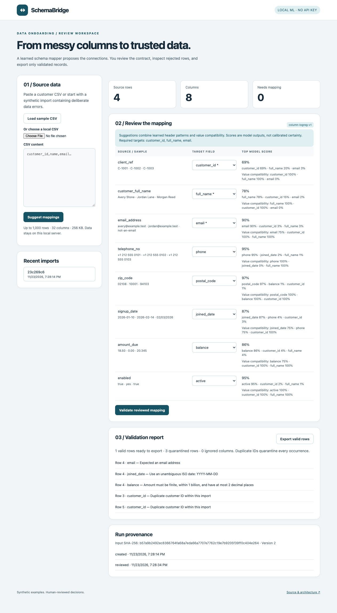

# SchemaBridge

**Make the mapping explicit. Make the import trustworthy.**

[](https://github.com/sunad30/schemabridge/actions/workflows/ci.yml)

A local ML workbench for customer-data onboarding: messy CSV → learned column suggestions → human-reviewed contract → row validation → clean export.



## Why it exists

An implementation engineer receives a customer's spreadsheet with unfamiliar column names, ambiguous dates, duplicate IDs, and inconsistent values. Guessing the mapping is easy; explaining and safely applying it is harder. SchemaBridge makes that boundary visible: ML proposes, the operator decides, deterministic validation controls what can leave the system.

## What works

- Learns header patterns and value compatibility from 80 versioned synthetic training examples.
- Combines character TF-IDF and a logistic regression classifier with global one-to-one assignment and abstention.
- Shows three candidate fields, sample values, and compatibility evidence for each source column.
- Lets an operator override or ignore any mapping before validating the full import.
- Quarantines malformed records and **every occurrence** of a duplicate customer ID; retains reasons and source row numbers.
- Preserves leading-zero ZIP codes and uses Decimal for money; protects exported text against spreadsheet formula injection.
- Persists review state with optimistic concurrency, audit history, and a source-content hash.

## AI approach and measured result

The classifier learns from header n-grams plus eight numeric value-compatibility features. A Hungarian assignment prevents two source columns from silently mapping to one destination. Dummy targets allow abstention; weak predictions (score below 0.35 or top-score margin below 0.08) require operator attention. Scores are **not calibrated confidence**.

The held-out smoke evaluation correctly mapped **8/8 new header aliases**. These aliases use familiar synthetic value distributions, so this result says little about unfamiliar domains. The provided import deliberately contains four records: one is exportable, two share an ID and are quarantined, and one contains invalid email/date/money values.

This is supervised ML, not an LLM call or a keyword-only mapper. The model is retrained deterministically from the checked-in corpus on first inference in each process. No arbitrary model files are deserialized.

## Run locally

Python **3.12+** (verified locally with 3.14). No API key, model download, Docker, cloud account, or paid service required. Initial dependency installation requires internet; inference is local.

```bash
git clone https://github.com/sunad30/schemabridge.git
cd schemabridge
python3 -m venv .venv
source .venv/bin/activate
# Windows PowerShell: .venv\Scripts\Activate.ps1
pip install -r requirements.txt
cp .env.example .env
uvicorn app.main:create_app --factory --host 127.0.0.1 --port 8011
```

Open **http://127.0.0.1:8011**. Interactive API docs: `/docs`. SQLite initializes automatically; `DATABASE_PATH` in `.env` selects its location. Stop the server with Ctrl+C. Each project should have its own virtual environment and database.

## Stack and engineering

| Layer | Implementation |
|---|---|
| Frontend | Accessible HTML, CSS, vanilla JavaScript; no build step or CDN |
| API | Python / FastAPI; typed requests, bounded uploads, explicit errors |
| ML | scikit-learn, NumPy, SciPy; reproducible random seeds |
| Persistence | SQLite transactions, version checks, audit events |
| Delivery | pytest, Ruff, GitHub Actions, pinned dependencies |

The small frontend keeps the data and ML workflow easy to inspect. A framework would be useful for a larger routing/state surface, but is not needed for this single workspace. All user-derived UI content uses text nodes. No employer code, customer records, or secrets are included.

## Verify

```bash
ruff check .
ruff format --check .
pytest -q
python -m scripts.evaluate
```

The evaluation prints a JSON report; a captured run is in [docs/evaluation.json](docs/evaluation.json). These are **small, synthetic evaluations**, not production benchmarks or business outcomes. See [architecture and tradeoffs](docs/architecture.md) and [demo walkthrough](docs/demo.md).

## Security and deployment boundary

This is a **single-user local prototype**, not a public multi-tenant service. Bind to loopback. Host allowlisting, same-origin checks, a 2 MB request-body limit, schema validation, CSP, safe text rendering, and transactional writes reduce risk; they do not replace authentication or infrastructure controls. SQLite is not encrypted. Redaction is incomplete. Use only synthetic data in demos; do not load secrets or real personal information.

Public deployment needs authenticated users, tenant isolation, TLS, retention/deletion controls, rate limiting, background job queues and resource limits, monitoring, and an independently reviewed threat model. No cloud deployment or external integration has been tested. Database files and `.env` are ignored by Git.

## Project status

An original, AI-assisted portfolio prototype. Implemented and tested against synthetic examples; no claimed production customers, operational savings, or prior employer deployment. MIT licensed. Review the implementation and reproduce the demo before presenting its design in an interview.
