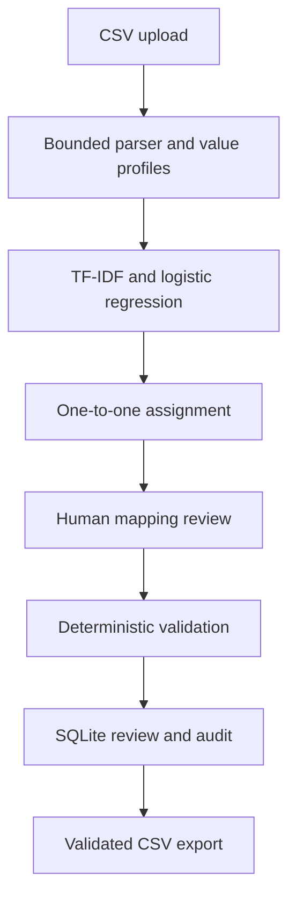

# Architecture and tradeoffs

`app/model.py` owns model features/training/inference. `app/schema.py` owns the target contract and canonical converters. `app/domain.py` owns parsing, validation, duplicate quarantine and export. `app/main.py` is the API adapter; `app/storage.py` handles atomic state transitions. UI code is isolated in `static/`.

## Contract decisions

Eight fixed customer fields; customer_id, full_name and email are required. Dates must be ISO calendar dates; there is no silent locale inference. Postal codes currently follow a US-only pattern. Monetary values must be finite, within bounds, and have at most two decimal places. Phone validation checks syntax, not deliverability. Source columns can be ignored explicitly. The model never bypasses these rules.

Mapping is reviewed as a whole, with exactly one decision for each source header. Database updates compare a version inside `BEGIN IMMEDIATE`; stale tabs receive HTTP 409 instead of overwriting a newer decision. Export requires a reviewed mapping. Audit records describe local revisions; there is no identity-backed reviewer attribution or cryptographic tamper protection.

## Important limitations

- A tiny English synthetic corpus can overfit naming conventions. Unfamiliar domains and multilingual headers are not validated.
- The score/margin thresholds are heuristics, not calibrated risk guarantees.
- Assignment can choose a non-top candidate to satisfy uniqueness. The UI exposes alternatives so the operator can override it.
- One file at a time, no streaming or background queue. Limits: 1,000 rows, 32 columns, 256 KB CSV.
- Raw input is saved locally to support repeatable review. There is no retention UI or encryption.
- No external CRM writes: export is the explicit integration boundary.

## Next engineering steps

Evaluate on a separately authored corpus with ambiguous and multilingual columns; add calibration and per-field error analysis; support versioned customer-specific contracts; add background jobs for large imports; add authenticated review and tenant isolation before deployment.
